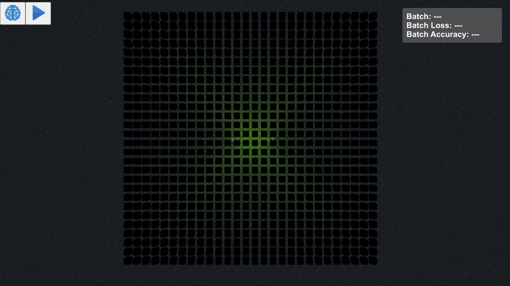
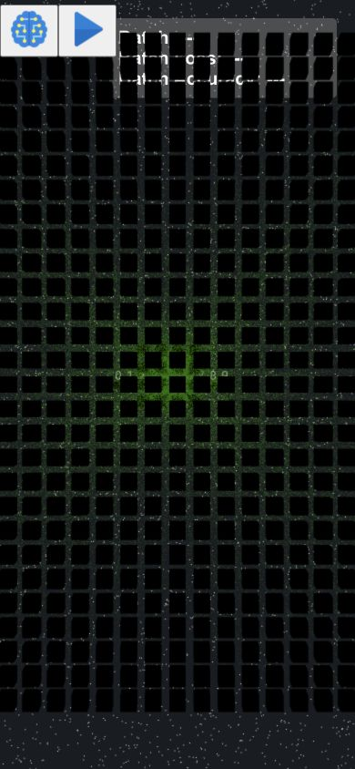
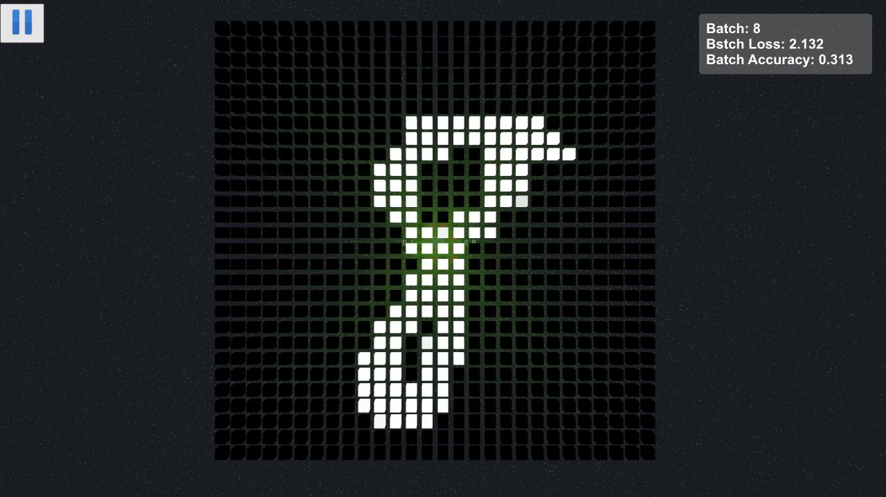

# Repository and site audit

Audited 3 October 2026 against commit `0ad56ee`. Application code and dependency manifests were not changed. The assessment combines source review, a local production build, automated checks, and desktop/phone-sized browser inspection.

## Assessment

Product direction clarified after this audit: prioritize visualizing actual training, richer animation/shaders, user control, and UI continuity with the word-embeddings explorer. See [ANN visualization design](ANN_VISUALIZATION_DESIGN.md) for the revised direction.

The project is a working foundation for an educational neural-network visualization, but the user journey is still a prototype. React, an isolated training worker, and instanced neuron meshes are sensible foundations. The first priority is to make loading, training, and playback reliable. The second is to explain what the user is seeing and make the network readable on smaller screens.

The configured public URL currently redirects to a portfolio page showing “Page not found.” The production build renders locally, but pressing Play before training generates repeated uncaught exceptions. After allowing more time for loading and training, playback did display digits and batch metrics. Model accuracy and clean end-to-end completion remain unverified.

## Checks performed

| Check | Result |
| --- | --- |
| Locked installation | `npm ci --ignore-scripts` succeeded; reported a Three.js peer mismatch. Lifecycle scripts were deliberately not needed for these checks. |
| Production build | `npm run build` succeeded with warnings. |
| Bundle size | Main JavaScript: 565.97 kB gzip; largest additional chunk: 310.69 kB gzip. These are build outputs, not measured network transfer or load-time scores. |
| Tests | `CI=true npm test -- --watchAll=false --runInBand` failed before executing tests: Jest cannot parse `import.meta.url` in `NeuralNetwork.js`. |
| Whole-source lint | `eslint src --format json`: 4 errors, 126 warnings across 17 files. Errors are undefined `THREE` references in the unused `helperFunctions/networkAnimations.js`. |
| Dependency audit | npm reported 73 vulnerable dependency entries: 3 critical, 36 high, 19 moderate, 15 low. See exposure notes below. |
| Browser | Local production build inspected at 1280 × 720 and 390 × 844 in the in-app Chromium browser. Play-before-training failure reproduced. Phone layout defects observed. |
| Public URL | `https://zmaqutu.github.io/3d-ann-visualizer` redirected to `https://zongo-is.me/3d-ann-visualizer`, which displayed a portfolio 404 page. |

No Lighthouse score, device FPS benchmark, heap profile, Safari/Firefox validation, or production exploit assessment was performed. Source-derived resource estimates below are not browser measurements.

## Prioritized findings

### 1. P1 — Playback reads missing queue entries

**Evidence:** `src/components/NeuralNetwork.js:485` and `:621–633`; Play is always available in `src/App.js:75`.

On a fresh page, clicking Play produces `TypeError: Cannot read properties of undefined (reading 'colorAttributeArray')` repeatedly. The first animation frame assumes an entry exists. At the end of a sample, the index is incremented and `.loss` and `.accuracy` are read before the bounds check. Consequently, even a fully populated queue will fail after its final entry; a producer/consumer gap can hit the same path sooner. The end-of-queue path is source-confirmed, not browser-reproduced through a completed training run.

**Fix:** Check queue availability before any dereference. Use explicit loading, ready, playing, paused, waiting-for-sample, complete, and error states. Disable Play until a sample is ready, and distinguish a temporarily empty queue from completed training. Render a recoverable error state.

**Acceptance:** Play before readiness is harmless; zero-, one-, and many-sample queues finish safely; a slow worker resumes playback when another sample arrives.

### 2. P1 — Rendering resets playback and creates extra workers

**Evidence:** `src/components/NeuralNetwork.js:40–58`, `:98–106`, `:158–160`, and `:672`.

Animation flags and `trainingInstanceID` are local variables, so toggling Play/Pause or clicking the input group resets them. Browser testing confirmed the reset: playback was paused at batch 14 and, after resuming, progressed through earlier batches again (observed at batch 8). `useState(new Worker(...))` evaluates the worker constructor on every render even though React retains only the initial state value. Cleanup terminates only the retained worker. Output-label positions have a related defect: a fresh empty array is populated inside a memo that only runs once, leaving subsequent renders without the positions.

**Fix:** Create and terminate the worker within one effect; keep its handle in a ref. Store the playback cursor and phase in stable refs/reducer state. Memoize and return label positions directly. Remove the unused input-group click state.

**Acceptance:** Repeated pause/resume preserves the current sample and phase; labels remain positioned; mount/unmount and Strict Mode checks do not leave extra workers alive.

### 3. P1 — Training has no readiness, failure, or recovery protocol

**Evidence:** `src/workers/worker.js:24–38`, `:84–99`; `src/ML Files/mnist_data.js:46–84`; `src/App.js:69–74`.

Initialization starts the asynchronous data load without awaiting it or reporting readiness. A Train message can call `nextTrainBatch` before indices and arrays exist. Fetch responses are not checked for HTTP failure, and worker errors are not propagated to a visible error/retry state. Clicking Train immediately removes the button, even if training fails. There is no completion event or restart control.

**Fix:** Serialize initialization and training behind a readiness promise; send typed ready, progress, sample, complete, and error messages. Add retry/cancel/reset controls and a repeated-training guard. Check response status and validate dataset dimensions before decoding.

**Acceptance:** A delayed or failed dataset request cannot start training prematurely; errors are visible and retry works; training completion restores useful controls.

### 4. P1 — Configured public destination does not serve the app

**Evidence:** `package.json:2`; browser navigation to that destination.

The configured homepage lands on the portfolio’s 404 screen. The remote repository slug is `3d-ann-visualuzer`, while the homepage uses `3d-ann-visualizer`; the discrepancy warrants checking but does not by itself prove the hosting cause. The build embeds `/3d-ann-visualizer/` as its asset base.

**Fix:** Choose and verify the canonical hosting path, align the build base with it, and automate a deployment smoke check for the HTML, JavaScript, and worker URLs. Check the domain/Pages configuration before changing the slug.

### 5. P2 — Dataset storage and tensor ownership waste memory

**Evidence:** `src/ML Files/mnist_data.js:54–55`, `:77–98`; `src/workers/worker.js:132–162`, `:183–193`.

The full image buffer occupies approximately **194.4 MiB**. Copying it into train and test arrays while retaining the original brings image-array storage to **388.8 MiB**, before decoded image data, canvases, tensors, and GPU allocations. This happens during initialization. Prediction batches and the image tensor returned by `getImagePixels` are not disposed. Scalar/comparison/cast intermediates in `getBlackBoxActivations` also escape explicit cleanup; a no-argument `tf.dispose()` does not provide ownership for them.

**Fix:** Load training data with explicit progress and reduce its retained representation; keep learning from an untrained network as the primary journey. Retain byte data until batching, or use views where ownership permits. Dispose prediction batches/image tensors in `finally`, wrap synchronous intermediates in `tf.tidy`, close the image bitmap, and cache activation-extraction models with clear ownership of shared weights.

**Acceptance:** Repeated predictions keep tensor counts stable after warm-up; restarting releases resources; actual mobile heap profiling establishes a practical memory budget.

### 6. P2 — Scene workload is high even when idle

**Evidence:** `src/components/NeuralNetwork.js:201–214`, `:262–301`, `:379–398`, `:675–753`, and `:768`.

The topology has 12,960 connections, rendered twice as 25,920 React `Segment` components, alongside 50,000 stars. Drei batches segments, so this is **not** a claim of 25,920 draw calls. The second segment set currently has coincident endpoints and its update calls are commented out. The scene also renders 816 relatively detailed sphere instances, and animation loops allocate matrices/vectors per instance per frame. Instancing is useful but does not eliminate geometry cost or allocation churn.

**Fix:** Remove the inactive connection set; use buffer-based lines and show selected/strong connections by default. Reduce sphere detail or use points, reuse scratch objects, make movement delta-time based, and introduce a low-quality setting. Pause decorative motion and use demand rendering when idle. Measure before setting FPS targets. This follows the general approaches in [React Three Fiber’s performance guidance](https://r3f.docs.pmnd.rs/advanced/scaling-performance).

### 7. P2 — The visualization can misrepresent model values

**Evidence:** `src/components/NeuralNetwork.js:196`, `:341–347`, `:621–629`; `src/workers/worker.js:129–130`, `:188`.

- Input byte colors are copied into an unnormalized float color attribute without dividing by 255, losing faithful grayscale intensity in the material pipeline.
- Hidden activations are reduced to binary values and supplied as one-component color attributes, rather than explicitly mapped RGB colors. That can be a design choice, but the UI does not explain that magnitude has been discarded.
- The output mesh allocates 16 instances for 10 classes, leaving six at their default transforms.
- Metrics are selected after advancing the cursor, so the first displayed metrics skip entry zero and can describe a different sample than the completed animation. They are training-batch statistics, not test-set accuracy.
- The apparent backward phase restores particle positions; it does not visualize computed gradients or weight updates.

**Fix:** Define an explicit mapping from model data to visual encoding; normalize colors; allocate exactly 10 outputs; show current-sample metadata and separately named training statistics. Describe the reverse motion as a visual reset unless actual gradient data is added.

### 8. P2 — Mobile layout and accessibility need a coherent UI shell

**Evidence:** `src/App.js:65–85`, `src/App.scss:233–246`, and browser screenshots below.

Both buttons expose the accessible name “play,” including Train and Pause. There are no visible instructions, loading status, layer names, legend, or textual prediction summary. At 390 px width the Play control overlaps the metrics horizontally, the canvas draws over the metrics, and the input grid extends beyond the viewport. The fixed camera faces the input grid directly, hiding the other layers on the initial desktop view. Correctness is shown using red/green without an equivalent textual explanation.

**Fix:** Add semantic labelled controls, an explicit overlay stacking layer, responsive panels, a camera fitted to the whole network, reset-view controls, keyboard interactions, reduced-motion behavior, and a textual equivalent of the prediction and network stages. Verify screen-reader output and actual touch devices separately.

### 9. P2 — Automated checks and dependency maintenance are weak

**Evidence:** `src/App.test.js`, `package.json`, `package-lock.json`, `src/helperFunctions/networkAnimations.js`; no checked-in CI workflow.

The sole test still expects the removed “learn react” link. Its current execution fails earlier on worker-module syntax. Whole-source lint also catches errors in code the production build does not include. The lockfile pins Three.js 0.149.0 while Drei’s nested `three-mesh-bvh` requires at least 0.151.0.

The npm audit flags 73 dependency entries, not 73 confirmed deployed exploits. Critical entries are `form-data`, `shell-quote`, and `websocket-driver`. Dependency tracing places `shell-quote` and `websocket-driver` in CRA development tooling; `form-data` appears through Jest/jsdom and TensorFlow’s `@types/node-fetch` chain. Runtime exposure needs separate assessment. Direct affected entries also include Drei and react-scripts. Do not blindly apply `npm audit fix --force`: npm suggests replacing react-scripts with `0.0.0` for part of the graph.

**Fix:** Replace obsolete tests with queue/state-machine tests and browser smoke tests, and run full lint/test/build in CI. Align compatible Three/Fiber/Drei versions. Migrate this client-only app to a maintained build tool such as Vite, then refresh and audit the dependency graph. React officially [deprecated Create React App in February 2025](https://react.dev/blog/2025/02/14/sunsetting-create-react-app). Keep that migration separate from the playback fixes so regressions are attributable.

### 10. P3 — Repository and site metadata still describe a scaffold

**Evidence:** `README.md`, `public/index.html:9`, `public/manifest.json`, unused layer components and styles.

The README is CRA boilerplate; the manifest still says “Create React App Sample.” Several alternate layer components, unused imports, empty files, and unrelated styles remain. The hidden `predictInput` route also calls `predict()` with no history, although `predict` immediately dereferences `history.history`; repair that before exposing the control.

**Fix:** Write a project-specific README with setup, architecture, dataset source/license, supported browsers, controls, and deployment instructions. Replace default metadata/icons, prune unused code and packages, and pin a supported Node version. The tracked `.env` contains a build-setting key; this audit found no basis to call it an exposed credential.

## Revised site improvement roadmap

The product goal is to watch the network learn. A prepared demo is not a priority. The detailed proposal is in [ANN visualization design](ANN_VISUALIZATION_DESIGN.md).

| Order | Work | Outcome |
| --- | --- | --- |
| 1 | Capture true forward values, loss, gradients, and actual optimizer updates; repair lifecycle and playback | Every displayed phase corresponds to a real training step |
| 2 | Adapt the word-embeddings UI: control rail, central scene, Training Step panel, and phase timeline | A coherent interface with useful control and numerical inspection |
| 3 | Build shared neuron shaders and batched connection ribbons with phase-driven pulses | Smooth forward/backward/update animation that supports pause and scrub |
| 4 | Add weight maps, selected-neuron isolation, stable color scales, and fixed probe comparisons | Users can inspect what changes as training progresses |
| 5 | Profile rendering/training contention, cap retained history, tune quality, and maintain tooling | A responsive, reproducible, maintainable visualization |

The first milestone should show one complete batch update accurately, from input through parameter change, within the new UI. Follow with continuous training and comparisons across recorded steps.

## Browser evidence

Desktop, initial loaded scene:

Phone-sized viewport, showing cropping and obscured metrics:

Playback after allowing loading/training time:

